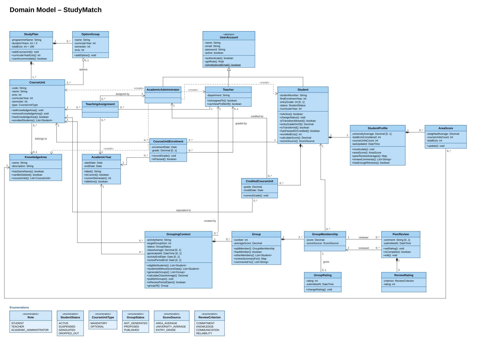

# Domain Model

Initial domain model for StudyMatch (Sprint 1), built from the domain concepts identified in the 22 [use cases](use-cases/README.md). It describes the problem, not the implementation: there are no primary or foreign keys, tables, controllers or repositories.

StudyMatch currently supports a single programme, Computer Engineering (Engenharia Informática).

## Class Diagram

## Enumerations

| Enumeration | Values | Used in |
|---|---|---|
| Role | STUDENT, TEACHER, ACADEMIC_ADMINISTRATOR | UC01 |
| StudentStatus | ACTIVE, SUSPENDED, GRADUATED, DROPPED_OUT | UC04, UC17 |
| CourseUnitType | MANDATORY, OPTIONAL | UC06 |
| GroupStatus | NOT_GENERATED, PROPOSED, PUBLISHED | UC17–UC19 |
| ScoreSource | AREA_AVERAGE, UNIVERSITY_AVERAGE, ENTRY_GRADE | UC18, UC21 |
| ReviewCriterion | COMMITMENT, KNOWLEDGE, COMMUNICATION, RELIABILITY | UC22 |

## Concepts kept as attributes

Some concepts from the use cases are simple values, so they are attributes instead of classes:

| Concept (use case) | Where it is |
|---|---|
| Role (UC01) | `UserAccount.getRole()`, derived from the subclass |
| StudentNumber, EntryGrade (UC02, UC16) | `Student.studentNumber`, `Student.entryGrade` |
| CurricularYear (UC03) | `Student.curricularYear` (derived), `CourseUnit.curricularYear` |
| Department (UC05) | `Teacher.department` |
| Semester, ECTS (UC06) | `CourseUnit.semester`, `CourseUnit.ects` |
| Grade (UC09, UC10) | `CourseUnitEnrolment.grade`, `CreditedCourseUnit.grade` |
| AcademicRecord (UC11) | the student's enrolments and credited course units |
| WeightedAverage (UC11, UC14) | `StudentProfile.universityAverage`, `AreaScore.weightedAverage` |
| Activity, GroupSize (UC17) | `GroupingContext.activityName`, `targetGroupSize`, `activityEndDate` |
| StudentScore, ClassAverage (UC18, UC21) | `GroupMembership.score` and `scoreSource`, `GroupingContext.classAverage` |
| ReviewPeriod (UC22) | `GroupingContext.activityEndDate` to `reviewPeriodEnd` |
| Rating, Comment (UC22) | `ReviewRating.rating`, `GroupRating.rating`, `PeerReview.comment` |

## Constraints

Accounts and students
- Emails and student numbers are unique, and only institutional emails are accepted (UC01, UC02, UC05).
- A new student starts as ACTIVE. A GRADUATED student can't go back to ACTIVE (UC04).
- `entryGrade` is between 0 and 200 and is converted to 0–20 by dividing by 10 (UC16).

Study plan and areas
- There is one study plan: Computer Engineering, 3 years, 180 ECTS.
- `ects` > 0, `semester` is 1 or 2 and `curricularYear` is between 1 and 3 (UC06).
- A curricular year can't exceed 60 ECTS. Only optional course units belong to an option group; the group has its own `ects` and counts once in that limit, and a student enrols in only one of its course units.
- A course unit belongs to at most one knowledge area. The Internship has none (UC13).
- Area names are unique, ignoring case and extra spaces. An area with course units can't be deleted (UC12).

Enrolments and grades
- A student can't enrol twice in the same course unit in the same academic year, or in one already passed or credited (UC08).
- Only active students can enrol, with at most 75 ECTS per academic year and 42 per semester (UC08).
- Grades go from 0 to 20; 10 or more is a pass (UC09, UC10).
- An enrolment keeps only its highest grade (e.g. regular exam or resit). If the student repeats the course unit in another year, the best grade of all enrolments counts (UC09).
- Only a teacher assigned to the course unit in that academic year can record its grades (UC07, UC09).

Profile
- For each course unit only the best grade counts (enrolments and credited grades), even if it's below 10.
- Averages are ECTS-weighted. Course units without an area count only for the overall average (UC14, UC15).
- Peer-review averages are calculated when the profile is opened, and only shown after at least 3 reviews (UC14).
- A teacher can only see profiles of students enrolled in course units they teach in the current academic year (UC14).

Groups
- A grouping context can only be created for a course unit with a knowledge area; `targetGroupSize` ≥ 2 (UC17).
- Only active students enrolled in that course unit and academic year are included. A student is in at most one group per context (UC17, UC18).
- Group sizes in a context differ by at most one (UC18).
- `score` = area average → university average → entry grade ÷ 10, using only course units completed before the current semester. `scoreSource` records which one was used (UC18, UC21).
- Students only see groups once the context is PUBLISHED and never see other students' grades or scores (UC19, UC20, UC21).

Peer reviews
- Reviews are allowed between `activityEndDate` and `reviewPeriodEnd` (UC22).
- Reviewer and reviewed are different members of the same group; one review per pair, with exactly one rating per criterion.
- Ratings go from 1 to 5. Each member gives at most one GroupRating to their own group.
- Reviews are anonymous (UC14, UC20, UC22).

## Why some things are modelled this way

Student, Teacher and AcademicAdministrator inherit from UserAccount because they share the login data (UC01) and each account has exactly one role.

The AcademicAdministrator has no methods of its own. The actions it starts (creating course units, enrolling students, crediting grades…) are described in the use cases, and the rules behind them belong to the classes that hold the data. The dashed «create» dependencies show which objects it creates, and it is linked to the records where the system needs to know who made the decision: teaching assignments (UC07) and credited course units (UC10).

The grade is stored in the CourseUnitEnrolment and only the highest one is kept, because StudyMatch only needs the best grade to form groups, not the full history of exams. Each academic year has its own enrolment, so a student who repeats a course unit keeps both grades and the best one counts.

Credited course units are separate from enrolments because they don't come from an enrolment or from a teacher; they come from a decision by the university when a student transfers.

StudyPlan exists even though there is only one programme. It holds the course units and owns the rules about the whole plan (3 years, 180 ECTS, at most 60 ECTS per curricular year), which no single course unit can check on its own (UC06).

OptionGroup represents the optional course units of the 3rd year, 2nd semester (Internet of Things, Computer Vision and Generative AI Programming). The student chooses one, so the group counts only once (4 ECTS) towards the 60 ECTS limit.

Peer reviews link two group memberships (reviewer and reviewed) instead of two students. That way a review always belongs to a specific group, and it's simple to check that both students were in the same one.

The score and its source are saved in each membership when the groups are generated, so the explanation of the groups (UC21) shows the values that were actually used even if grades change later.
